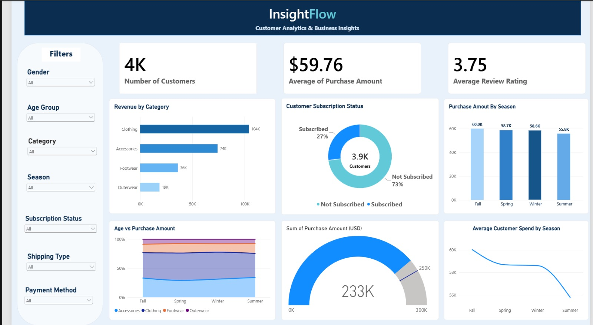

# 📊 InsightFlow – Customer Shopping Behavior Analysis

An end-to-end data analytics project using **Python, SQL, and Power BI** to analyze customer shopping behavior, purchasing patterns, product categories, seasonal trends, and subscription status.

## 📌 Project Overview

InsightFlow transforms customer shopping data into meaningful business insights using Python, SQL, and Power BI. The project analyzes **3,900 customer records** to explore customer preferences, purchase amounts, product category performance, seasonal trends, and subscription behavior.

## 🎯 Objectives

- Analyze customer purchasing and spending behavior.
- Identify top-performing product categories.
- Understand customer subscription patterns.
- Compare purchasing behavior across seasons.
- Explore customer demographics and shopping preferences.
- Analyze customer review ratings.
- Generate actionable business insights.

## 🛠️ Tools & Technologies

- **Python** – Data exploration and analysis
- **Google Colab** – Python notebook execution
- **SQL** – Data querying and business analysis
- **Microsoft Power BI** – Interactive dashboard development
- **Power Query** – Data transformation
- **DAX** – Measures and calculated metrics
- **GitHub** – Project documentation and version control

## 🖼️ Dashboard Preview

*InsightFlow dashboard built using Microsoft Power BI.*

## 📈 Key Performance Indicators

| Metric | Result |
|---|---:|
| Total Customers | 3,900 |
| Average Purchase Amount | $59.76 |
| Average Review Rating | 3.75 |
| Subscribed Customers | Approximately 27% |
| Non-Subscribed Customers | Approximately 73% |

## 🔍 Key Analysis

- **Customer Analysis:** Explore demographics, age groups, gender, and shopping preferences.
- **Purchase Analysis:** Compare purchase amounts across product categories.
- **Subscription Analysis:** Examine subscribed and non-subscribed customers.
- **Seasonal Analysis:** Compare purchase amounts across Fall, Spring, Summer, and Winter.
- **Customer Satisfaction:** Analyze average customer review ratings.
- **Business Analysis:** Use SQL queries and dashboard visuals to identify trends and opportunities.

## 💡 Key Business Insights

- **Clothing** contributes the highest purchase amount among the product categories displayed in the dashboard.
- **Accessories** is another significant contributor to purchase amount.
- Approximately **73% of customers are not subscribed**, suggesting an opportunity to investigate subscription adoption.
- Seasonal comparisons help identify differences in purchasing activity.
- Customer review ratings provide an overview of customer feedback.

*Insights are based on the current dashboard and may vary when filters are applied.*

## 📁 Project Files

| File | Description |
|---|---|
| `Customer_dataset.csv` | Customer shopping behavior dataset |
| `InsightFlow Dashboard.pbix` | Interactive Power BI dashboard |
| `InsightFlow_Customer_Analytics.ipynb` | Python analysis notebook developed in Google Colab |
| `InsightFlow_Customer_Analytics.jpeg` | Dashboard preview image |
| `InsightFlow_sql_queries.sql` | SQL queries for customer behavior analysis |
| `README.md` | Project documentation |

## 📊 Dashboard Features

- KPI cards for key customer metrics
- Purchase amount by product category
- Customer subscription status visualization
- Seasonal purchase amount comparison
- Customer spending and category analysis
- Interactive slicers for customer segmentation
- Consistent styling and business-focused visualizations

## 💼 Business Value

InsightFlow demonstrates how customer data can be transformed into actionable insights to understand purchasing preferences, evaluate subscription engagement, compare seasonal trends, and support informed marketing and customer retention decisions.

## 📚 Skills Demonstrated

- SQL querying and business analysis
- Python-based data analysis
- Data exploration and interpretation
- Power BI dashboard development
- Data visualization and KPI reporting
- Customer segmentation
- Analytical thinking and business problem-solving

## 👨🏻‍💻 About the Author

**Yash Ravindra Shiraskar**

Electronics And Computer Science Engineering Student | Aspiring Data Analyst

---

*InsightFlow — Turning Customer Data into Actionable Business Insights.*
